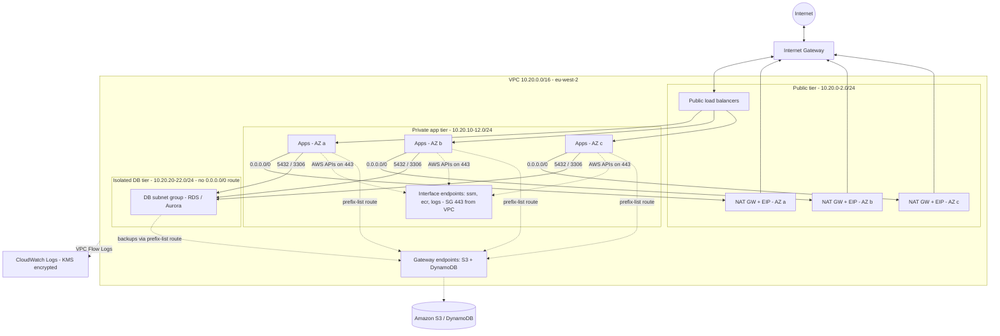

# terraform-aws-vpc-foundation


A production-style, multi-AZ AWS VPC module written from scratch (it does not wrap `terraform-aws-modules/vpc`), with dev and prod examples and an offline test suite.

## In plain English

This builds the private network that everything else in an AWS account sits inside. It splits the network into three layers in each data centre (Availability Zone): a public layer that faces the internet, a private layer for applications that can call out but cannot be reached from outside, and a sealed database layer with no internet path at all. One switch chooses how much you pay for outbound internet resilience, from none, to one shared gateway, to one per data centre. Every subnet address is calculated from a single network range, so there are no hand-typed IP lists to get wrong.

## Architecture

Traffic flow for the prod example (three AZs, one NAT per AZ). Dev is the same shape with two AZs and a single NAT.



### Subnet layout - default example (`examples/dev`, `10.0.0.0/16`, newbits 8)

| Tier | AZ | CIDR | Route to 0.0.0.0/0 |
|------|----|------|--------------------|
| public | eu-west-2a | `10.0.0.0/24` | Internet Gateway |
| public | eu-west-2b | `10.0.1.0/24` | Internet Gateway |
| private | eu-west-2a | `10.0.10.0/24` | NAT gateway (single, in eu-west-2a) |
| private | eu-west-2b | `10.0.11.0/24` | NAT gateway (single, in eu-west-2a) |
| isolated | eu-west-2a | `10.0.20.0/24` | none |
| isolated | eu-west-2b | `10.0.21.0/24` | none |

### Subnet layout - `examples/prod` (`10.20.0.0/16`, newbits 8)

| Tier | eu-west-2a | eu-west-2b | eu-west-2c | Route to 0.0.0.0/0 |
|------|-----------|-----------|-----------|--------------------|
| public | `10.20.0.0/24` | `10.20.1.0/24` | `10.20.2.0/24` | Internet Gateway |
| private | `10.20.10.0/24` | `10.20.11.0/24` | `10.20.12.0/24` | NAT gateway in the same AZ |
| isolated | `10.20.20.0/24` | `10.20.21.0/24` | `10.20.22.0/24` | none |

The formula is `cidrsubnet(cidr_block, subnet_newbits, subnet_netnum_offsets[tier] + az_index)`. Offsets default to `public = 0`, `private = 10`, `isolated = 20`, which leaves gaps for future tiers and makes the third octet tell you the tier at a glance. Both tables are asserted by `terraform test`.

## What it demonstrates

- Designing a VPC from first principles rather than wrapping a community module.
- IP address planning with `cidrsubnet()`, plus validation that rejects overlapping or oversize plans before any API call.
- Cost-versus-resilience trade-offs encoded as a single validated enum (`nat_gateway_mode`).
- Defence in depth: isolated tier with no default route, locked-down default security group, KMS-encrypted flow logs, least-privilege IAM.
- Private connectivity to AWS services with gateway and interface VPC endpoints.
- EKS readiness through Kubernetes load balancer discovery tags.
- Offline, credential-free testing with `terraform test` and `mock_provider`, plus tflint and checkov in CI.

## Features

| Feature | Variable(s) | Default |
|---------|-------------|---------|
| VPC with DNS support and hostnames | `cidr_block` | `10.0.0.0/16` |
| 2 or 3 AZs, auto-selected or pinned | `az_count`, `azs` | `2`, auto |
| Computed subnet CIDRs for three tiers | `subnet_newbits`, `subnet_netnum_offsets` | `8`, `0/10/20` |
| NAT strategy: none, single, one_per_az | `nat_gateway_mode` | `single` |
| Private route table per AZ in HA mode | derived from `nat_gateway_mode` | - |
| Isolated tier with no internet route + DB subnet group | `create_db_subnet_group` | `true` |
| VPC Flow Logs to KMS-encrypted CloudWatch Logs | `enable_flow_logs`, `flow_logs_retention_days`, `flow_logs_traffic_type`, `flow_logs_max_aggregation_interval` | on, 365 days, ALL, 600s |
| S3 and DynamoDB gateway endpoints on private + isolated route tables | `enable_gateway_endpoints` | `true` |
| Interface endpoints with HTTPS-from-VPC security group | `interface_endpoints` | `[]` |
| Default security group stripped of all rules | always on | - |
| Default NACL brought under management | always on | - |
| Kubernetes ELB discovery tags | `enable_kubernetes_tags`, `kubernetes_cluster_name` | off |
| No auto-assigned public IPs | `map_public_ip_on_launch` | `false` |

## Quick start

### Free path - no AWS account needed

```bash
cd examples/dev
terraform init -backend=false -input=false
terraform validate
terraform test        # 21 plan-only tests against a mocked AWS provider

cd ../prod
terraform init -backend=false -input=false
terraform test        # 5 tests
```

Or from the repo root: `make all` (fmt, validate, lint, test, security, docs).

`terraform plan` against real AWS needs credentials, but creates nothing.

### Real deploy

> **Cost warning:** NAT gateways bill per hour from the moment they exist. The dev example costs roughly USD 40/month, prod roughly USD 270/month before data charges. Destroy when finished.

```bash
cd examples/dev
cp terraform.tfvars.example terraform.tfvars   # adjust if needed
terraform init
terraform plan -out tfplan
terraform apply tfplan

# when finished
terraform destroy
```

See [docs/RUNBOOK.md](docs/RUNBOOK.md) for deploy, destroy and troubleshooting steps.

## Cost estimate

Approximate, on-demand, eu-west-2, not verified against current AWS pricing - check the [AWS Pricing Calculator](https://calculator.aws/).

| Item | Unit price (approx.) | dev (2 AZ, single NAT) | prod (3 AZ, NAT per AZ, 6 endpoints) |
|------|----------------------|------------------------|--------------------------------------|
| NAT gateway hours | ~USD 0.05/hour each | 1 x ~USD 37 | 3 x ~USD 37 = ~USD 110 |
| NAT data processing | ~USD 0.05/GB | usage-based | usage-based |
| Public IPv4 (NAT EIPs) | ~USD 0.005/hour each | ~USD 4 | ~USD 11 |
| Interface endpoints | ~USD 0.011/hour per endpoint per AZ | USD 0 (none) | 6 x 3 AZ = ~USD 145 |
| KMS key (flow logs) | ~USD 1/month | ~USD 1 | ~USD 1 |
| Flow logs ingestion + storage | ~USD 0.5-0.6/GB ingested | usage-based, low | usage-based |
| VPC, subnets, IGW, route tables, gateway endpoints | free | USD 0 | USD 0 |
| **Approximate fixed total** | | **~USD 42/month** | **~USD 267/month** |

Always run `terraform destroy` when you are done with a test deployment.

## Design decisions

| Decision | Why | Trade-off |
|----------|-----|-----------|
| Written from scratch, not wrapping the community VPC module | Shows the underlying resources and keeps the surface small and auditable | Fewer features (no IPv6, no transit gateway) than the community module |
| `nat_gateway_mode` enum instead of two booleans | One validated value cannot express contradictory states such as "single and per-AZ" | Adding a new mode needs a code change |
| Private route table per AZ only in `one_per_az` | Keeps AZ failure blast radius contained when it matters, avoids needless resources otherwise | Switching modes replaces route table associations |
| Isolated tier has a route table with no default route | Databases cannot reach or be reached from the internet even if a security group is misconfigured | Patching or external calls from that tier need an endpoint or proxy |
| Gateway endpoints on private and isolated tables | S3/DynamoDB traffic skips NAT (saves per-GB charges) and lets isolated workloads reach backups | Endpoint policies are left open; tighten per workload |
| Subnet CIDRs from offsets + `cidrsubnet()` | Deterministic, reviewable, testable offline; no copy-paste errors | All tiers share one subnet size per VPC |
| Default NACL left permissive, default SG emptied | Security groups are stateful and easier to reason about; NACL rules often break ephemeral ports | No subnet-level deny layer by default |
| Flow logs to CloudWatch with a dedicated KMS key | Queryable with Logs Insights, encryption scoped to one log group via key policy condition | Costlier than S3 destination at high volume |

## Testing & CI

| Check | What it does |
|-------|--------------|
| `terraform fmt -check -recursive` | Enforces canonical formatting |
| `terraform validate` | Schema and reference check for both examples against the real AWS v6 provider schema |
| `terraform test` (dev, 21 runs) | Plan-only, mocked provider. Asserts CIDR math for 10.0.0.0/16, 172.16.0.0/20 and newbits 4; NAT/EIP/route-table counts for `none`, `single`, `one_per_az`; each private route table points at the NAT in its own AZ; isolated route table never receives a 0.0.0.0/0 route; gateway endpoints attach to the isolated table; DB subnet group uses only isolated subnets; flow log KMS and retention; toggles remove resources; Kubernetes tags; locked default SG; validation rejects bad CIDR, host-address CIDR, /26 VPC, `az_count = 5`, unknown NAT mode and overlapping offsets |
| `terraform test` (prod, 5 runs) | Three AZs, three NATs, three private route tables, six interface endpoints, naming, environment validation |
| `tflint --recursive` | Terraform recommended preset plus the AWS ruleset |
| `checkov` | Static security analysis; see skips below |

CI runs all of the above on every push to `main` and on pull requests (`.github/workflows/ci.yml`).

## Security

Controls applied:

- Isolated subnets have no route to an internet or NAT gateway; this is asserted in tests.
- Default security group has all rules removed, so resources launched without an explicit SG get no access.
- Public subnets do not auto-assign public IPs.
- Interface endpoint security group allows only TCP 443 from the VPC CIDR.
- VPC Flow Logs (ALL traffic by default) to a CloudWatch Logs group encrypted with a customer-managed KMS key with rotation enabled.
- KMS key policy grants CloudWatch Logs use of the key only for this log group (`kms:EncryptionContext:aws:logs:arn` condition).
- Flow log IAM role: trust limited to `vpc-flow-logs.amazonaws.com` with an `aws:SourceAccount` condition; permissions limited to writing streams in the one log group.

Checkov skips (each justified in `.checkov.yaml`):

| Check | Reason |
|-------|--------|
| CKV_AWS_109, CKV_AWS_111, CKV_AWS_356 | Raised on the KMS key policy. In a key policy `Resource = "*"` means "this key"; the root statement is required by AWS and the logs statement is condition-scoped |
| CKV_AWS_338 | Module default and prod retain flow logs 365 days; dev uses 30 days to save cost |
| CKV_AWS_394 | AZ list is sliced to `az_count` and can be pinned with `var.azs`, so new AZs do not change the selection |

## Module reference

Inputs, outputs and resources: [modules/vpc/README.md](modules/vpc/README.md) (generated by terraform-docs). Deeper design notes: [docs/ARCHITECTURE.md](docs/ARCHITECTURE.md).

## Roadmap / Production hardening

- IPv6 dual-stack with egress-only internet gateway.
- Per-tier NACLs (including prefix-list-aware rules for the isolated tier).
- Restrictive VPC endpoint policies (e.g. S3 limited to organisation buckets).
- Transit Gateway or VPC Lattice attachment for multi-VPC estates.
- IPAM pool allocation instead of a static `cidr_block`.
- Flow logs to S3 with Athena tables for cheaper long-term retention.
- Route 53 Resolver query logging and DNS Firewall.

## Related repos

- [terraform-aws-state-bootstrap](https://github.com/mhkhan01/terraform-aws-state-bootstrap)
- [terraform-aws-vpc-foundation](https://github.com/mhkhan01/terraform-aws-vpc-foundation) (this repo)
- [terraform-aws-ecs-fargate-platform](https://github.com/mhkhan01/terraform-aws-ecs-fargate-platform)
- [terraform-aws-eks-platform](https://github.com/mhkhan01/terraform-aws-eks-platform)
- [terraform-aws-serverless-api](https://github.com/mhkhan01/terraform-aws-serverless-api)
- [terraform-aws-static-site](https://github.com/mhkhan01/terraform-aws-static-site)
- [terraform-aws-security-baseline](https://github.com/mhkhan01/terraform-aws-security-baseline)

## Author

Mohammed Haris Khan - Cloud Engineer, Birmingham UK - [GitHub @mhkhan01](https://github.com/mhkhan01) - [LinkedIn](https://www.linkedin.com/in/mohammed-haris-khan)
