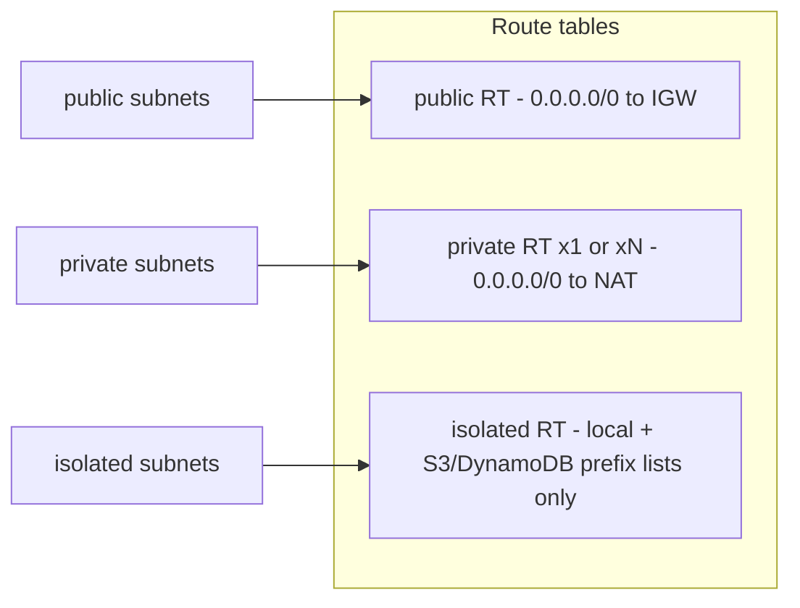

# Architecture

## Overview

`modules/vpc` creates one VPC spread over two or three Availability Zones. Each AZ gets three subnets:

| Tier | Purpose | Default route |
|------|---------|---------------|
| public | Load balancers, NAT gateways, bastion-free ingress points | Internet Gateway |
| private | Application compute (ECS, EKS nodes, Lambda in VPC) | NAT gateway, or none when `nat_gateway_mode = "none"` |
| isolated | Databases and anything that must never touch the internet | none, ever |



## Subnet maths

```
cidr = cidrsubnet(var.cidr_block, var.subnet_newbits, var.subnet_netnum_offsets[tier] + az_index)
```

With `10.0.0.0/16`, newbits `8` and offsets `0 / 10 / 20`:

```
10.0.0.0/16
 |- 10.0.0.0/24   public   AZ a
 |- 10.0.1.0/24   public   AZ b
 |- 10.0.2.0/24   public   AZ c (when az_count = 3)
 |- 10.0.10.0/24  private  AZ a
 |- 10.0.11.0/24  private  AZ b
 |- 10.0.12.0/24  private  AZ c
 |- 10.0.20.0/24  isolated AZ a
 |- 10.0.21.0/24  isolated AZ b
 |- 10.0.22.0/24  isolated AZ c
 '- 10.0.23.0 - 10.0.255.0  free for future tiers or peering ranges
```

Guard rails enforced by variable validation:

- `cidr_block` must be a valid IPv4 network address (host bits zero) between /16 and /24.
- `cidr_block` prefix + `subnet_newbits` must be at most /28 (AWS minimum subnet size).
- Tier offsets must be non-negative and at least 3 apart, so a third AZ never overlaps the next tier.
- The highest offset + 3 must fit inside `2^subnet_newbits`.

## ADRs

### ADR-001: Build the VPC from raw resources

- **Status:** accepted
- **Context:** The community `terraform-aws-modules/vpc` is excellent but large; wrapping it hides the design decisions this repo is meant to show.
- **Decision:** Implement directly with `aws_vpc`, `aws_subnet`, `aws_route_table` and friends.
- **Consequences:** Smaller, auditable surface. Features such as IPv6 and secondary CIDRs are out of scope until needed.

### ADR-002: `nat_gateway_mode` enum

- **Status:** accepted
- **Context:** Boolean pairs like `enable_nat_gateway` + `single_nat_gateway` allow meaningless combinations.
- **Decision:** One string variable with values `none`, `single`, `one_per_az`, validated.
- **Consequences:** Clear intent in code review. `one_per_az` also switches to one private route table per AZ so each AZ egresses through its own NAT.

| Mode | NAT gateways | EIPs | Private route tables | Private default route | AZ failure impact on egress |
|------|--------------|------|----------------------|-----------------------|-----------------------------|
| none | 0 | 0 | 1 | none | n/a (no egress) |
| single | 1 | 1 | 1 | NAT in first AZ | all AZs lose egress if first AZ fails |
| one_per_az | az_count | az_count | az_count | NAT in same AZ | only the failed AZ |

### ADR-003: Isolated tier has no default route

- **Status:** accepted
- **Context:** Security groups can be misconfigured; a missing route is a second, independent control.
- **Decision:** The isolated route table only carries the implicit local route and gateway endpoint prefix-list routes.
- **Consequences:** Databases can still reach S3 (backups, exports) and DynamoDB privately. Anything else needs an interface endpoint or a proxy in the private tier.

### ADR-004: NACLs stay permissive

- **Status:** accepted
- **Context:** NACLs are stateless; tight rules must also allow ephemeral return ports, and they cannot reference the S3/DynamoDB prefix lists used by the gateway endpoints.
- **Decision:** Manage the default NACL (so drift is visible) but keep allow-all rules; rely on security groups and routing.
- **Consequences:** No subnet-level deny layer. Listed on the roadmap.

### ADR-005: Flow logs to CloudWatch Logs with a dedicated KMS key

- **Status:** accepted
- **Context:** Flow logs are the main forensic record for network events.
- **Decision:** CloudWatch Logs destination, customer-managed KMS key with rotation, key policy scoped to the single log group ARN via encryption context, IAM role scoped to that log group.
- **Consequences:** Logs Insights queries work immediately. At high volume S3 is cheaper; that is a roadmap item.

### ADR-006: Interface endpoints are opt-in

- **Status:** accepted
- **Context:** Each interface endpoint costs per AZ-hour, which dominates the bill for small environments.
- **Decision:** `interface_endpoints` defaults to `[]`; prod enables SSM, ECR and Logs endpoints so instances and tasks work without NAT for AWS APIs.
- **Consequences:** Dev relies on NAT for AWS API calls.
